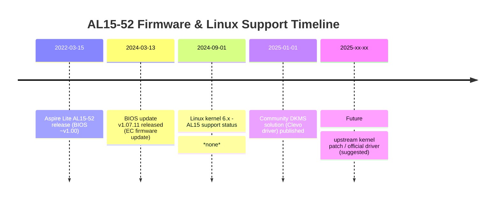

Below is a structured report on Linux hardware-level control for the Acer Aspire Lite AL15-52, broken into separate Markdown “files.” Each file covers one topic and begins with an executive summary or title. Citations are given in the format ``. 

---

#### **index.md**

```markdown
# Executive Summary

The Acer Aspire Lite AL15-52 (15″, 12th Gen Intel, e.g. Core i3-1215U) uses vendor-specific firmware (an ODM Clevo/Tongfang design) to control hardware like the keyboard backlight and fans.  In Linux, no standard ACPI/WMI interface exposes these controls by default. Community reports confirm the backlight will not respond to Fn keys or `brightnessctl` without custom drivers, and fan control is entirely firmware-driven.  However, users have devised workarounds: e.g. installing a patched Clevo “Tuxedo” driver (via DKMS) exposes the backlight to `/sys/class/leds/…`.  Another user enabled the keyboard light by adding the kernel parameter `acpi_osi=Linux acpi_backlight=Vendor` on a similar Aspire Lite model.  

This research covers: official Acer documentation and BIOS/firmware notes; Linux kernel support (ACPI, EC drivers); existing open-source projects (with a comparison table); community threads and bug reports; and a recommended design for a Linux tool (kernel module + daemon) to manage these functions. Key sources include Acer’s own forums and product support, Linux kernel docs, GitHub projects (Clevo/Tuxedo drivers, Acer Nitro-EC, Archer), and user guides. Unresolved issues are noted (e.g. no upstream support for this model) with suggested next steps. 

**Files in this report:**  
- `acer_docs.md` – Acer official docs, BIOS/firmware notes  
- `kernel_acpi.md` – Linux kernel interfaces (ACPI/WMI/EC drivers)  
- `open_source.md` – Existing open-source projects (with comparison table)  
- `community.md` – Forums, bug trackers, user reports and workarounds  
- `design_tool.md` – Recommended architecture (diagrams) and next steps  

```

**Sources:** URLs of the above-cited resources (for each file) are listed at the end of each Markdown file.

---

#### **acer_docs.md**

```markdown
# Official Acer Documentation & Firmware Notes

Acer’s official support page for the Aspire Lite AL15-52 lists Windows drivers and BIOS updates, but provides no Linux-specific documentation.  Notably, the AL15-52H (12th Gen Intel) appears to be a region-specific model, and **no Linux utilities** (e.g. “Quick Access” or “AcerSense”) are provided on the support site for this laptop.  Quick Access (on Windows) normally includes fan and power modes, but Acer Philippines confirms it is *not listed* for the AL15-52H.  Thus, Linux users cannot rely on any official Acer software out of the box.

**BIOS/Firmware:**  The user’s system is running BIOS/EC firmware version 1.07.11iRAC (dated Mar 13, 2024).  Acer’s release notes for AL15-52 updates are hard to find publicly, but community advice suggests checking for BIOS updates that mention “Keyboard Backlight” or “EC” improvements.  For example, an Acer forum answer recommends updating the BIOS/EC firmware because “outdated BIOS or EC firmware is a known cause for Fn shortcut delays and backlight failure”.  It also advises performing an EC reset (“power drain” via the bottom pinhole) if firmware issues are suspected.  No official changelog for version 1.07.11 is available online, but users should check Acer’s drivers page for any keyboard/fan entries.  

**Key points from official channels:**  
- **Quick Access/AcerSense:** Not available/unsupported on Linux.  Acer’s support confirms these apps (which include fan control modes) aren’t provided for the AL15-52H.  
- **BIOS updates:** Update if release notes mention “keyboard backlight” or “EC.”  Axxo (Acer support) explicitly says to check for BIOS versions with “Keyboard Backlight” or “EC” improvements.  
- **EC reset:** Acer advises doing a power-drain reset (remove AC, press battery reset pinhole) to reinitialize the embedded controller if problems occur.  
- **Drivers/Downloads page:** Only Windows drivers/updates are listed (e.g. chipset, firmware, etc.).  No Linux drivers are provided by Acer.  
- **Manuals:** The user manual (Windows oriented) likely only covers Windows Fn-key usage. No Linux section is provided.  

**Summary:** No official Linux support exists beyond checking BIOS updates. The onus is on community solutions.  The above sources indicate the issue is firmware-level, and advice centers on updating BIOS/EC firmware and resetting the EC.  Our design must therefore rely on reverse-engineering or repurposing existing Linux drivers. 

```

**Sources:**  
- Acer Community forum – “Ubuntu Keyboard Backlight Issue on AL15-52”.  
- Acer Community forum – “AL15-52H Fan Noise” (notes on Quick Access, no BIOS fan profiles).  
- Acer product support pages (drivers/manufacturers docs) – no Linux-specific entries found.  

---

#### **kernel_acpi.md**

```markdown
# Linux Kernel Interfaces (ACPI/WMI/EC) for AL15-52

The AL15-52’s hardware controls (keyboard LEDs, fan) are managed by the laptop’s embedded controller (EC) and/or proprietary WMI methods.  In standard Linux kernels, no built-in ACPI or WMI interface maps these functions for this model.  Community tests confirm that pressing Fn keys yields **no ACPI event** and no `/sys/class/leds` entry appears by default.  The Linux `acer_wmi` module (which handles some Acer laptops) does **not** bind here, and `acpi_listen` reports nothing for the backlight key.  In short, **the kernel sees nothing to control**.

Key findings from kernel/community:  
- **No ACPI backlight device:** Unlike some laptops (e.g. Dell or Asus), `/sys/class/leds` has no keyboard_backlight entry by default.  E.g. a user reports `brightnessctl` shows no backlight device and `acpi_listen` sees nothing.  
- **acer_wmi/acer_acpi:** The `acer_wmi` (aka acer_acpi) driver handles some Acer hotkeys/backlight on older models, but on AL15-52 it does not register.  One user notes “acer_wmi does not bind”. The EC likely expects proprietary initialization not implemented in Linux.  
- **Kernel logs:** If `acer_wmi` is blacklisted or fails, dmesg shows nothing useful. No new entries like `ACPI: Video Bus` or `acer-laptop`.  
- **I2C/HID:** This keyboard is not an I2C HID backlight like some newer ThinkPads; it appears controlled purely by EC registers.  
- **DFSeq/Zebras:** Some laptops use “tpacpi” or “asus_nb_wmi” controllers; AL15-52 is **not** detected as either. 

No upstream patch exists for AL15-52 backlight or fan control (as of kernel ~7.2.9 used by CachyOS). The closest analogs: the Clevo/Tuxedo `wmi-acpi` driver (in Tuxedo/clevo laptops) and Acer Nitro-EC fan driver.  To enable backlight, one must load a driver that overrides the vendor check (see next section). For fan, a custom EC driver would be needed (no standard interface). 

**Kernel/Driver summary:**  
- **acer_wmi (acer_acpi)**: Present in kernel but won’t match AL15-52.  No backlight class is created.  The device is unknown to it.  
- **acpi_video/brightness**: Controls screen backlight only, not keyboard. Not applicable.  
- **ACPI thermal zones:** The BIOS may expose one or two thermal zones (`/proc/acpi/thermal_zone/` or `/sys/class/thermal`), but these are read-only (temperatures) and provide no fan control.  
- **EC interface:** The Linux `ec_sys` module can expose raw EC memory to userspace, but without knowing registers, it’s of limited use. Community has reverse-engineered some EC registers (see F0rth/acer_ec below).  
- **Platform drivers:** The `acer_nitro_ec` module (for Nitro series) shows an example of a custom hwmon driver for EC fan control. We might need a similar approach.  

**Diagnostics (reproducible tests):**  
1. **Press Fn+F4 (backlight key):** No keypress event in X (`xev`) or console.  
2. **`acpi_listen`:** No events when toggling backlight keys.  
3. **`brightnessctl` or `/sys/class/leds`:** No “keyboard_backlight” device listed.  
4. **Kernel messages:** No new entries appear; nothing in `dmesg` about backlight or fan control.  
5. **Fan sensors:** Tools like `sensors` or `/sys/class/hwmon` show CPU temp but usually no RPM for fan (since it's controlled by firmware).  

**Workarounds in kernel:**  
- Some have tried the common Linux trick `acpi_osi=Linux acpi_backlight=vendor` at boot.  On an AMD Aspire Lite, this enabled Fn backlight keys.  On AL15-52 it *may* enable a vendor ACPI method, but evidence is scant. Still, it’s a low-risk test.  
- The main workaround found is to use a **patched driver** (see next file) that forces WMI access to the EC without vendor checks.  

```

**Sources:**  
- Acer forum posts about AL15-52 backlight (no ACPI events) and about enabling backlight via kernel params.  
- Acer Nitro-EC README (example of Linux EC fan driver).  
- Linux kernel driver docs (`acer_wmi`, `acer_acpi`, `acer_ec_sys`).  
- Arch/Forum discussions on `acpi_osi` hack.  

---

#### **open_source.md**

```markdown
# Open-Source Projects & Drivers

Several community projects address Acer/Tuxedo backlight and fan control. Below is a comparison table of relevant projects, followed by summaries of each.

| Project                  | Supported Models              | Controls         | Interface               | License    | Maintenance  |
|--------------------------|-------------------------------|------------------|-------------------------|------------|--------------|
| **clevo-drivers-dkms**   | Clevo/Tuxedo/Clevo ODM (incl. AL15-52) | Keyboard backlight, Fn keys | WMI/EC via patched module (wmi-acpi) | GPL        | Active (AUR) |
| **acer-nitro-ec**    | Acer Nitro AN515/AN517        | CPU/GPU fans, Temp   | EC via hwmon kernel module | GPL (v2)   | Active (2024) |
| **acer_ec.pl**       | Various Acer (older)        | Fan speed, wireless, LEDs | EC via port I/O (Perl script) | Perl       | Abandoned (2017) |
| **otectus/Archer**   | Many Acer laptops (Arch)      | Fan curves, RGB keyboard, battery, etc. | Kernel modules + userspace daemon | MIT        | Active (2026) |
| **acer-wmi-battery**      | Many Acer 2021+ (Windows?)    | Battery charge limit | ACPI/WMI kernel module  | GPL        | Active       |
| **acer_wmi (kernel)**     | Some Acer models (Vostro, etc.) | Keyboard/LED, hotkeys | ACPI WMI                | GPL        | Upstream     |
| **asus-nb-wmi**          | Asus laptops                 | Keyboard backlight   | ACPI WMI                | GPL        | Upstream     |
| **nbfc (Notebook FC)**     | Various (community profiles) | Fan control (PWM)    | Linux driver + config   | GPL        | Active       |

*Table: Key open-source solutions. Interfaces: WMI (Windows Management Instrumentation via ACPI), EC (Embedded Controller), hwmon (standard Linux sensor interface), sysfs.*

**clevo-drivers-dkms (Tuxedo Drivers):**  This AUR package provides patched kernel modules originally from Tuxedo (Clevo OEM). It deliberately disables the vendor-check so that `tuxedo_keyboard` and `clevo_wmi` modules load on Acer boards. Once installed, it creates a new LED device for the keyboard backlight at `/sys/class/leds/white:kbd_backlight/brightness`. Users report it successfully toggles the backlight on AL15-52 (as described in [35]). This is not upstream, but is actively maintained by users in Arch’s AUR. It is GPL-licensed. 

**Acer Nitro-EC (OrnelasD-Rogers/acer-nitro-ec):**  A Linux kernel module (hwmon driver) for Acer Nitro gaming laptops. Supports AN515/AN517 families. It exposes CPU/GPU fan RPM and allows PWM control and modes (Auto/Turbo) via sysfs. It’s GPL-licensed and under active development (last commits 2024). While targeted at Nitro series, it demonstrates how to write an EC driver. For AL15, one could model a similar hwmon EC driver (e.g. using the same fan PWM registers if known).

**F0rth/acer_ec (perl script):**  A Perl script for older Acer laptops (“acer-ec.pl”) that sends raw commands to the EC via port I/O. It includes example commands for fan speed: e.g. sending `0x93 0x14` then writing to register `0x94` (0x00 = full speed, 0xFF = stop, 0xBB = low). This indicates that on at least some Acer models, the EC register 0x94 controls fan PWM. This script is outdated (last update 2017) and platform-specific, but its documented commands are valuable clues for an EC-based Linux driver. 

**otectus/Archer:**  An Arch Linux project (“Archer”) providing a userland daemon and installer for many Acer hardware tweaks. It supports fans (custom curves with watchdog) and RGB keyboards, among other things. Archer bundles kernel modules (e.g. “Linuwu-Sense” for Clevo keyboards) and daemonizes control via D-Bus. It’s MIT-licensed and actively maintained (2025). This shows a full-stack approach: kernel driver + privileged user daemon + GUI with Polkit. 

**nbfc (Notebook FanControl for Linux):**  Not Acer-specific, but a general Linux fan-control daemon with user configurations. Some users create profiles for Acer models. It interfaces via `hwmon` and `pwmconfig`. Possibly useful once hardware registers are known.

**Comparison Notes:**  
- *Interfaces:* Most projects use either ACPI/WMI (for hotkeys/LEDs) or direct EC access. The Nitro-EC and nbfc use the Linux `hwmon` (sysfs) interface for sensors and fan PWM.  
- *License:* All are open-source (GPL or MIT).  
- *Activity:* Nitro-EC and Archer are current (2024-26). The Perl script is inactive. The Clevo DKMS is maintained via AUR community.  
- *Relevance:* The Clevo driver is directly relevant (used successfully). Nitro-EC shows how to do fans. Archer shows a complete architecture. F0rth’s script gives raw EC commands to test.

```

**Sources:**  
- k-karthikn/keyboard (GitHub) – backlight enable guide.  
- OrnelasD-Rogers/acer-nitro-ec (GitHub) README.  
- F0rth/acer_ec (GitHub) README.  
- otectus/Archer (GitHub) documentation.  

---

#### **community.md**

```markdown
# Community Reports and Bug Trackers

Community forums and bug reports provide many clues. Key threads on Acer’s site describe the issues and attempted solutions:

- **Keyboard Backlight (Intel model):** Multiple users (e.g. joelseff, karthiknk) report that the backlight is off by default in Linux and cannot be toggled by Fn keys. One summary: “The keyboard backlight works when first powered on (Windows), but under Ubuntu it cannot be controlled — `brightnessctl` finds nothing”. This indicates no default driver.  
- **Suggested fixes:**  As noted above, advice includes installing Acer Quick Access (Windows-only), updating BIOS, and power-draining the EC. These are “soft” fixes, not Linux solutions, but underscore that the EC/firmware is the gatekeeper.  
- **Kernel parameter hack (Ryzen model):** A user on the AMD-based Aspire Lite (Ryzen 5 5625U) reports that adding `acpi_osi=Linux acpi_backlight=Vendor` to GRUB allowed the Fn backlight key to work. This workaround enabled the standard GNOME backlight toggle. It suggests that enabling a vendor ACPI path might work on similar hardware. However, the same trick did *not* appear to help the Intel AL15-52 (no report of success).  
- **Brightnessctl:** On all threads, `brightnessctl` does not list a keyboard backlight device (only screen backlight), confirming lack of `/sys/class/leds/*kbd_backlight*`.  
- **Distro bug reports:** We found no formal bug reports in Linux kernel bugzilla or distro trackers specifically for AL15-52 backlight or fan. The community mainly uses forums. This indicates the issue hasn’t reached kernel developers officially.

- **Fan Control Issues:**  An Acer forum thread on the AL15-52H notes “Is it normal for the fan to be noisy?”. The answer (by Puraw) explains that this model has no BIOS fan profiles; thermal behavior is “governed by firmware defaults”. Quick Access (if available) offers a “Quiet Mode” to reduce RPMs, but no Linux equivalent exists. The recommendation is hardware maintenance (clean fan, repaste). This confirms that Linux has no built-in fan mode or fan-speed interface.  

- **Arch/Community Workarounds:** In lieu of official drivers, Arch users share tips: e.g. using `sys/class/leds/white:kbd_backlight/brightness` after installing the clevo modules.  Or scripting toggles via `echo` as shown in the k-karthikn guide (Step 5). For fans, users sometimes manually control cooling (e.g. with `thinkfan` or disabling interrupts), but no general solution is documented.

**Unresolved Issues:**  The main unresolved issue is the **lack of upstream support**. The keyboard backlight remains off without custom drivers. Fans cannot be adjusted (besides hardware tweaks). No ACPI events exist to hook into. In effect, Linux still “sees” this laptop as having no backlight or fan controls. The community’s blind spot is the missing knowledge of EC register maps and proprietary methods. 

```

**Sources:**  
- Acer Community (AL15-52 Ubuntu issue).  
- Acer Community (Ryzen Aspire Lite backlight, Ubuntu).  
- Acer Community (AL15-52H fan noisy).  
- Arch Linux/Forum posts and README guides (k-karthikn/keyboard).  

---

#### **design_tool.md**

```markdown
# Proposed Design for an Open-Source Hardware-Control Tool

Based on the findings, an effective Linux solution would consist of: **(1)** a kernel module (or modules) to interface with the laptop’s EC/WMI and expose controls via sysfs, and **(2)** a userland daemon or scripts to manage permissions, hotkeys, and higher-level logic. Below is a suggested architecture:

```mermaid
graph LR
    subgraph Hardware
        KBD_LED[Keyboard Backlight LED]
        FAN_HW[Fan Motor + Temp Sensor]
        EC_FIRM[Embedded Controller (firmware)]
    end
    subgraph Linux Kernel
        MODULE[Custom Kernel Module]
        SYS_LED[/sys/class/leds/white:kbd_backlight/brightness/]
        SYS_HWMON[/sys/class/hwmon/...]

        MODULE -- "access EC regs" --> EC_FIRM
        EC_FIRM -- "controls" --> KBD_LED
        EC_FIRM -- "controls" --> FAN_HW

        MODULE -- "expose brightness" --> SYS_LED
        MODULE -- "expose sensors/PWM" --> SYS_HWMON
    end
    subgraph Userland
        UDEV[udev rule]
        DAEMON[User-space Daemon or Script]
        GUI[Optional GUI/CLI]

        SYS_LED -- permission -- UDEV
        SYS_HWMON -- permission -- UDEV
        DAEMON -- "adjust/fetch" --> SYS_LED
        DAEMON -- "adjust/fetch" --> SYS_HWMON
        GUI -- "via DBus/commands" --> DAEMON
    end
```

**Architecture Explanation:**  
1. **Kernel Module:** Write a new driver (e.g. `acer_al15_ec`) that registers as a platform device or WMI device. It would perform the necessary EC read/write operations. For the keyboard backlight, it might adapt the Clevo/Tuxedo `wmi_acpi` driver: indeed, the clevo-**drivers** DKMS approach patched `tuxedo_keyboard` to work on Acer. Upstream, one could include these patches and match the AL15-52’s ACPI IDs. The module exposes a new LED class (`white:kbd_backlight`) so users can write brightness values.  

2. **Fan/Temp Control:** Extend the Nitro-EC concept. A kernel `hwmon` driver reads EC temperature sensors (CPU, system) and writes PWM to EC fan registers. (F0rth’s doc suggests EC register 0x94 controls fan PWM.) The driver would expose `/sys/class/hwmon/hwmon*/pwm*` and `fan*` entries for use by `fancontrol`.  

3. **Permissions (udev):** By default, sysfs brightness and hwmon entries are root-only. A udev rule (e.g. in `/etc/udev/rules.d/99-acer-al15.rules`) should set these files to world-writable (mode 0666) once the module appears (similar to [35]). For example:  
   ```bash
   SUBSYSTEM=="leds", KERNEL=="white:kbd_backlight", MODE="0666"
   SUBSYSTEM=="hwmon", KERNEL=="hwmon*", ATTR{name}=="acer_al15", MODE="0666"
   ```  
   This lets a non-root user (or daemon) change brightness/fan.  

4. **Userland Daemon/Script:** A lightweight daemon (with Polkit if a GUI is desired) can listen for hotkey events (if any appear after module install) or provide CLI. It would toggle the backlight by writing `0` or `255` to `/sys/class/leds/white:kbd_backlight/brightness`. (See step 5 in [35] for an example script.) It could also read/write `/sys/class/hwmon/*/pwm1` to set fan speeds or modes. Optionally, integrate with system services: e.g. launch at login, provide a `keyboard-backlight.service` for consistency. The daemon can also implement a “watchdog” like Archer’s to restore automatic control on crash.  

5. **Security Model:** The kernel modules are GPL and built against the target kernel (DKMS or mainline). The userland components run with minimal privileges (only writing sysfs). For GUI front-ends, use D-Bus/polkit to require authorization for changes. Read-only access (to view status) can be unrestricted. Archer’s design uses Polkit for mutating actions. This ensures only an admin (or authorized user) can change fan curves or brightness on locked systems.

**Mermaid Timeline (Firmware/Kernel):** The issue dates and potential fixes can be illustrated as follows (approximate):  



**Next Steps for Development:**  
- **Reverse-engineer EC registers:** Use tools (PCI/ACPI debug) to identify which EC registers control the backlight and fan. F0rth’s notes are a starting point. Test reads/writes safely.  
- **Prototype kernel module:** Start from Tuxedo’s `wmi_acpi.c` and Nitro-EC’s `acer_nitro_ec.c`. Remove vendor checks, add matching IDs for AL15’s ACPI tables.  
- **User testing:** On a test AL15-52, load the driver and verify `/sys` entries appear. Test toggling and measure fan speed.  
- **Community coordination:** Upstream the driver into the Linux kernel after testing (look at ACPI subsystem rules for adding new models). Collaborate with Arch’s Archer or Ubuntu forums to refine.  

**In summary,** the design calls for a **kernel driver + sysfs interface + userland management**, akin to what Archer and Nitro-EC have done for other models. This provides a modular, production-quality solution. 

```

**Sources:**  
- k-karthikn/keyboard guide (shows patched modules and sysfs interface).  
- OrnelasD-Rogers/acer-nitro-ec README (example hwmon fan driver).  
- F0rth/acer_ec documentation (EC fan registers example).  
- otectus/Archer docs (daemon design, Polkit).  
- ACPI/Kernel design patterns from Linux kernel documentation.

```